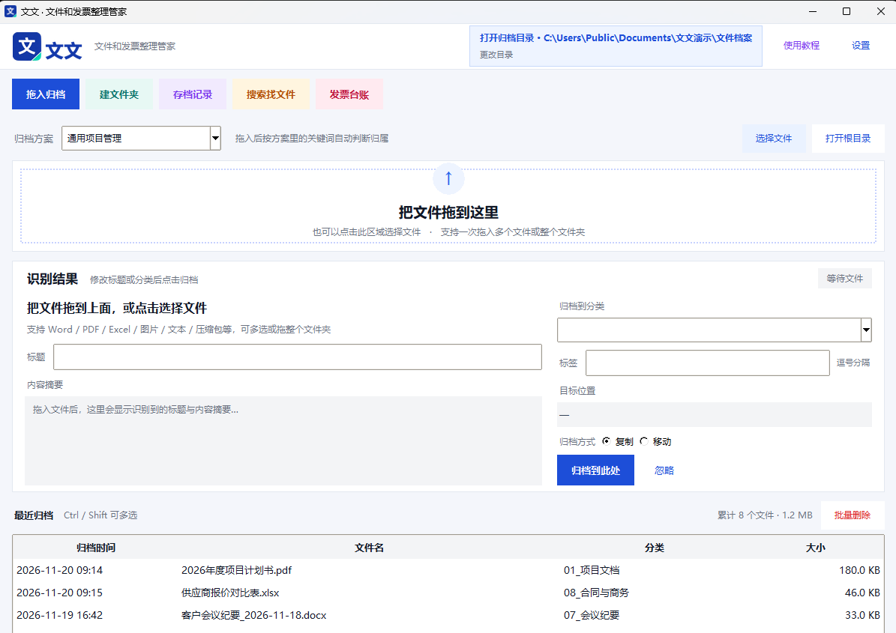
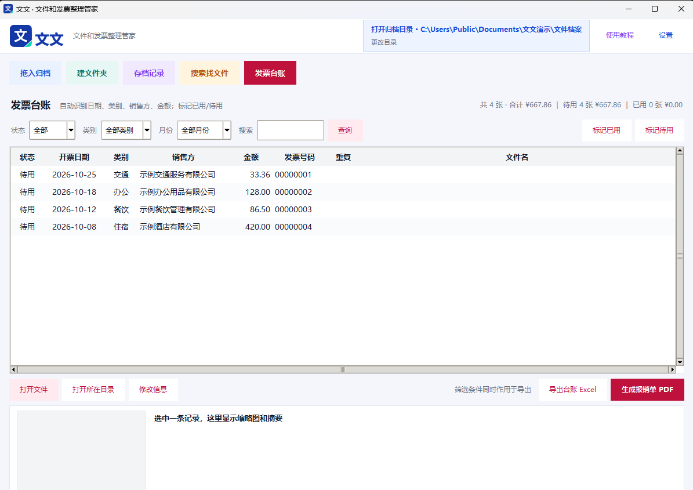

# WenWen · 文文

**A local-first Windows file and invoice organizer.**

[简体中文](README.zh-CN.md) | English

[](https://github.com/harrisonfu8-design/wenwen-open-source/actions/workflows/codeql.yml)
[](LICENSE)
[](https://sw.olilily.com/)

WenWen is a Windows desktop app for people who keep losing files. Drop a document into the window and it reads the content, suggests a title and category, files it into the right folder, and records every move so you can search, export, and reconcile invoices later.



## What it does

- **Drag-and-drop filing** — PDF, Word, Excel, images, text, and archives. Content-aware category suggestions with a manual override before anything is moved.
- **Folder templates** — ready-made structures for project management, quality inspection, customer sales, and personal archives; or paste your own folder list.
- **Audit trail** — every filing records time, title, category, and full path. Export to Excel, undo, and batch rename.
- **Search** — find files by name, title, content summary, or category. Open the file or its folder from the result list.
- **Invoice ledger** — extracts date, seller, category, amount, and invoice number from PDF invoices, scans, and itineraries. Duplicate warnings, filters, Excel export, and merged reimbursement PDFs.
- **Local-first** — file contents and the ledger stay on your machine. Licensing, orders, support chat, and brand-logo requests contact the official service endpoint described in [PRIVACY.md](PRIVACY.md).



## Download

- Official installer: <https://sw.olilily.com/dl/WenWen_Setup_v1.5.20.exe>
- English product page: <https://sw.olilily.com/en/>
- User guide: <https://sw.olilily.com/guide/>
- Product page: <https://sw.olilily.com/>
- Microsoft Store listing (submitted, in certification):
  <https://apps.microsoft.com/detail/9P9JJXPMMX1G>

> **Signing status:** v1.5.20 is currently **unsigned** (`NotSigned`). Windows SmartScreen may show “Unknown publisher”. See [Code signing](#code-signing) below. Verify the SHA-256 hash before running any build. The v1.5.20 Store MSIX was submitted on 2026-11-23 and is in Microsoft certification; Store installs will be re-signed by Microsoft after certification passes.

The installer displays a privacy policy page before installation; the user must
select the consent checkbox to continue. The same text is installed as
`隐私政策.txt` in the install directory.

## Verify your download

```powershell
Get-FileHash .\WenWen_Setup_v1.5.20.exe -Algorithm SHA256
Get-AuthenticodeSignature .\WenWen_Setup_v1.5.20.exe | Format-List Status,StatusMessage,SignerCertificate
```

Expected SHA-256 for the official v1.5.20 installer (87,845,212 bytes):

```text
DB7664DD60BCBBA4EFC87D41443E2C36607AA6CEA046D801E1D67F9A3031A20F
```

`Status` is expected to be `NotSigned` until a trusted code-signing certificate is issued. Full checks: [docs/VERIFICATION.md](docs/VERIFICATION.md).

## Source scope — semi-open

This repository is **semi-open source**, not fully open source. It publishes the Windows UI shell, installer, documentation, and client-side licensing/support UI. The core recognition, invoice-extraction, and OCR algorithms, and the hosted backend, are closed source and are not included.

- Public scope and file list: [docs/OPEN_SOURCE_SCOPE.md](docs/OPEN_SOURCE_SCOPE.md)
- License: [WenWen Semi-Open Source License v1.0](LICENSE) — source-available, not OSI-approved
- `filekeeper/core.py`, `filekeeper/invoice.py`, and `filekeeper/ocr.py` are placeholders that raise `ImportError`
- The public tree is **not a complete build**. `build.ps1` stops with an explicit message; official binaries include the private core
- The public repository runs CodeQL only; build and release workflows live in the private repository

## Project status

- **Source:** UI shell, installer, documentation, and client-side licensing/support UI are public. Core algorithms and the licensing/order/support backend are closed.
- **CI:** CodeQL analyzes the public Python files. There is no public build workflow.
- **Build provenance:** the official installer is distributed from <https://sw.olilily.com/> with a published SHA-256. The earlier public CI release was retired during the semi-open transition.
- **Releases:** see [CHANGELOG.md](CHANGELOG.md).
- **Press / media:** [docs/media-kit.md](docs/media-kit.md) has accurate boilerplate, screenshots, facts, and signing-status wording.
- **FAQ:** [docs/faq.md](docs/faq.md) covers signing, SmartScreen, privacy, offline use, source scope, and verification.
- **Microsoft Store MSIX:** [docs/msix.md](docs/msix.md) records the Store package identity, the `0x8007007b` fix, and the current certification submission.
- **Citation:** [CITATION.cff](CITATION.cff) provides machine-readable citation metadata.
- **Code signing:** the SignPath Foundation free OSS program was **not approved on 2026-11-22** for insufficient public visibility. A semi-open project with a closed core is not a good fit for that program. No certificate has been issued, and no binary is claimed to be signed.
- **Privacy:** [PRIVACY.md](PRIVACY.md). **Security:** [SECURITY.md](SECURITY.md).

## Code signing

The signing policy is documented in [CODE_SIGNING_POLICY.md](CODE_SIGNING_POLICY.md). In short:

- **No trusted certificate is currently in use.** The v1.5.20 installer and client are `NotSigned`.
- A closed-core semi-open project is not eligible for the SignPath Foundation OSS program in its current form. A paid code-signing certificate is the realistic path.
- We will publish the signer identity and verification steps here once a certificate is actually issued.

## Contributing

Bug reports, documentation fixes, installer improvements, and UI-shell contributions are welcome. Core algorithms are not part of this repository, so do not submit core code or private data.

- [Issues](https://github.com/harrisonfu8-design/wenwen-open-source/issues)
- [Discussions](https://github.com/harrisonfu8-design/wenwen-open-source/discussions)
- [Contributing guide](CONTRIBUTING.md)
- [Code of Conduct](CODE_OF_CONDUCT.md)

Good first contributions: improve English documentation, verify installer behavior on different Windows versions, test the public UI shell, or report SmartScreen behavior with sanitized details.

## License

WenWen Semi-Open Source License v1.0. See [LICENSE](LICENSE) and [docs/OPEN_SOURCE_SCOPE.md](docs/OPEN_SOURCE_SCOPE.md). The WenWen name, 文文, logo, and website content are not licensed as your own brand.
