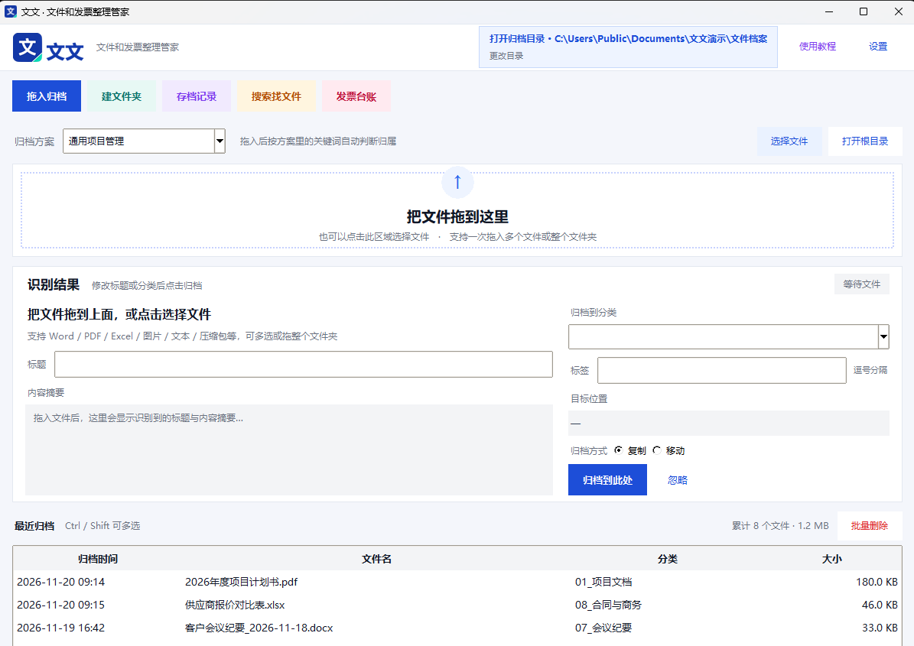
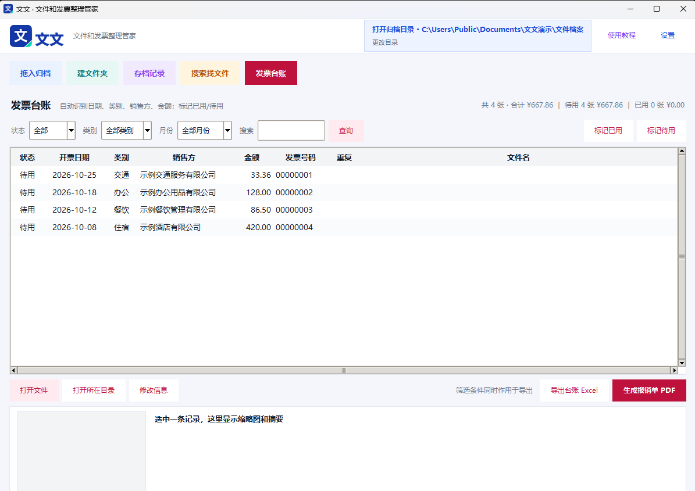

# 文文 · 文件和发票整理管家

**Windows 本地文件与发票整理工具。**

[English](README.md) | 简体中文

[](https://github.com/harrisonfu8-design/wenwen-open-source/actions/workflows/codeql.yml)
[](LICENSE)
[](https://sw.olilily.com/)

文文是一个给「不擅长整理文件、总是找不到文件」的人用的 Windows 小工具。把文件拖进窗口，它会读取内容、判断分类、生成标题、归档到对应文件夹，并记录每一次归档，方便之后搜索、导出和整理发票。



## 功能

- **拖入自动归档**：支持 PDF、Word、Excel、图片、文本、压缩包；按内容关键词和文件类型判断分类，可手动改标题与分类后再归档。
- **批量建文件夹**：内置大数据项目、项目管理、质量检验、客户销售、个人资料库等目录方案，也可粘贴自己的目录清单批量生成。
- **存档记录**：每次归档都记录时间、标题、分类和完整路径，可导出 Excel，支持撤销与批量重命名。
- **搜索找文件**：按文件名、标题、正文摘要、分类搜索；双击打开文件，右键打开所在文件夹。
- **发票台账**：识别电子发票 PDF、扫描件和行程单中的日期、销售方、类别、金额、发票号；支持去重提示、筛选、Excel 导出和报销单 PDF 合并。
- **本地优先**：文件内容和台账默认只保存在本机，不上传文件内容；授权、订单、在线客服与品牌 Logo 请求会访问官方服务端，详见 [PRIVACY.md](PRIVACY.md)。



## 下载与验证

- 官方安装包：<https://sw.olilily.com/dl/WenWen_Setup_v1.5.20.exe>
- 英文产品页：<https://sw.olilily.com/en/>
- 使用教程：<https://sw.olilily.com/guide/>
- 产品页：<https://sw.olilily.com/>
- Microsoft Store 商店页（已提交，正在认证）：
  <https://apps.microsoft.com/detail/9P9JJXPMMX1G>

> **签名状态：** v1.5.20 当前为 `NotSigned`，Windows 可能提示“未知发布者”。运行前请核对 SHA-256。v1.5.20 Store MSIX 已于 2026-11-23 提交，正在微软认证；认证通过后商店安装包由微软重签名。

安装向导会先展示隐私政策页，必须勾选同意后才能继续；同一文本会安装为 `隐私政策.txt`。

官方 v1.5.20 安装包（87,845,212 字节）SHA-256：

```text
DB7664DD60BCBBA4EFC87D41443E2C36607AA6CEA046D801E1D67F9A3031A20F
```

完整校验说明：[docs/VERIFICATION.md](docs/VERIFICATION.md)。

## 源码范围 — 半开源

本仓库是**半开源**，不是完整开源项目。公开 Windows UI 壳、安装器、文档和客户端授权/客服界面；核心识别、发票解析、OCR 算法和托管后端闭源，不在本仓库。

- 公开范围与文件清单：[docs/OPEN_SOURCE_SCOPE.md](docs/OPEN_SOURCE_SCOPE.md)
- 许可证：[WenWen Semi-Open Source License v1.0](LICENSE)，源码可见但非 OSI 认可的开源许可证
- `filekeeper/core.py`、`filekeeper/invoice.py`、`filekeeper/ocr.py` 是占位文件，导入即抛 `ImportError`
- 公开树**不能完整构建**；`build.ps1` 会明确停止，官方二进制包含私有核心
- 公开仓库只运行 CodeQL；构建与发布工作流在私有仓库

## 项目状态

- **源码：** UI 壳、安装器、文档、客户端授权/客服界面公开；核心算法与授权/订单/客服后端闭源。
- **CI：** 仅对公开 Python 文件运行 CodeQL；没有公开构建工作流。
- **构建来源：** 官方安装包由 <https://sw.olilily.com/> 分发并公布 SHA-256；此前的公开 CI 发布已在半开源切换时退役。
- **变更记录：** [CHANGELOG.md](CHANGELOG.md)。
- **代码签名：** 2026-11-22 申请 SignPath Foundation 免费开源签名，**未获批准**，原因是公开可见度不足。带闭源核心的半开源项目也不适合该 OSS 项目；现实路径是付费代码签名证书。目前没有签发任何证书，不声称已签名。
- **隐私：** [PRIVACY.md](PRIVACY.md)。**安全：** [SECURITY.md](SECURITY.md)。媒体资料：[docs/media-kit.md](docs/media-kit.md)。常见问题：[docs/faq.md](docs/faq.md)。Store MSIX：[docs/msix.md](docs/msix.md)。引用：[CITATION.cff](CITATION.cff)。

## 代码签名政策

完整说明见 [CODE_SIGNING_POLICY.md](CODE_SIGNING_POLICY.md)。要点：

- **当前没有可用的受信任证书**，v1.5.20 为 `NotSigned`。
- 带闭源核心的半开源项目目前不符合 SignPath Foundation 免费开源签名条件；付费证书是现实方案。
- 在证书真正签发前，不会使用 SignPath Foundation 的签名表述，也不会声称已签名。

## 参与

欢迎提交可复现的 Bug、文档修正、安装器改进和 UI 壳贡献。核心算法不在本仓库，请勿提交核心代码或私有数据。

- [Issues](https://github.com/harrisonfu8-design/wenwen-open-source/issues)
- [Discussions](https://github.com/harrisonfu8-design/wenwen-open-source/discussions)
- [贡献指南](CONTRIBUTING.md)
- [行为准则](CODE_OF_CONDUCT.md)

适合首次参与的事项：改进英文文档、在不同 Windows 版本验证安装器、测试公开 UI 壳、反馈 SmartScreen 行为（请脱敏）。

## 许可证

WenWen Semi-Open Source License v1.0，见 [LICENSE](LICENSE) 与 [docs/OPEN_SOURCE_SCOPE.md](docs/OPEN_SOURCE_SCOPE.md)。文文名称、Logo 与官网内容不因代码许可而自动授权为你的品牌。
